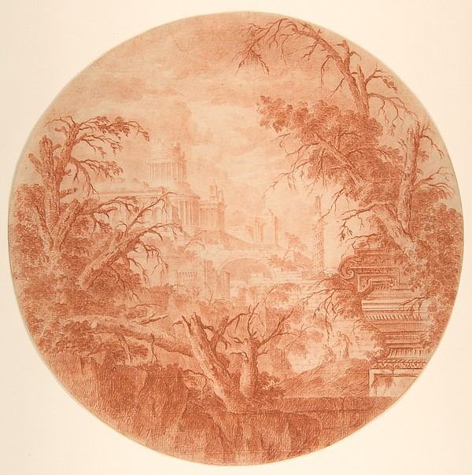
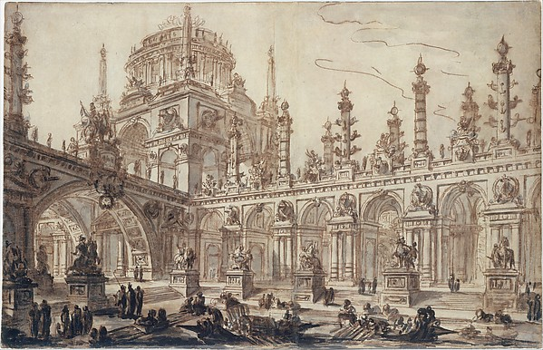
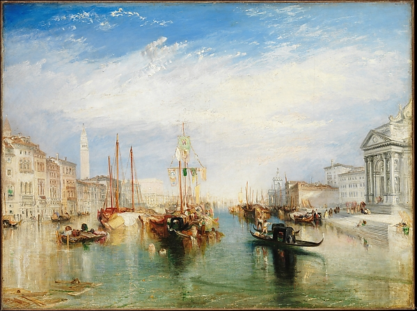
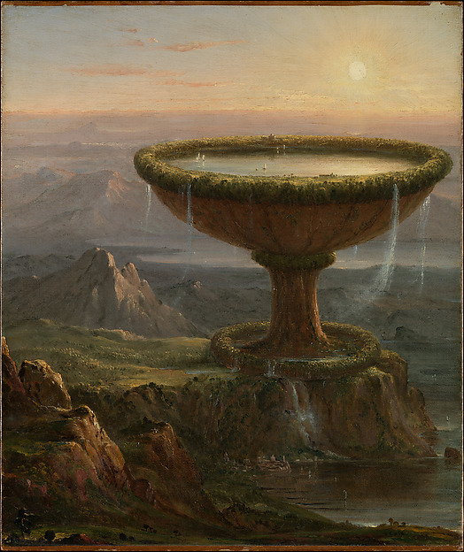

# Painterly Architecture References

Implementation follow-up, 2026-09-11: full-resolution Legeay and Challe originals
now supply three local transparency masks. [The backdrop guide](../../DISTANT_ARCHITECTURE.md)
documents extraction, Painterly/Geometric comparison and verification. Original
holdings are not runtime dependencies; Turner and Cole remain references only.

Research date: 2026-09-10. Four visually inspected public-domain references from
The Metropolitan Museum of Art. The initial research step changed no gallery
code, runtime asset, seed logic or material setting.

## Recommendation

Start with Legeay's distant central buildings and Challe's ink-wash architecture.
They offer irregular drawn edges and tonal detail that simple generated polygons
do not. Use Turner as a reference for painterly haze, and Cole for monumental
scale rather than a literal goblet asset.

A proposed next experiment is a small bank of manually selected architectural
cutouts, converted to soft alpha masks while preserving the source's wash or chalk
variation. Tint the masks with Azure Sky's existing blue; let the current seeded
generator vary their placement, scale, overlap and distance fade. Do not introduce
the original brown paper, foreground people, boats, trees or whole compositions
into the interface. Do not mirror lettering or recognizable landmarks casually.
This preserves procedural arrangement while making the source shapes painterly.
No masks or interface variants have been produced in this research step.

## Shortlist

### 1. Jean Laurent Legeay: Architectural Fantasy

**Ca. 1785-90. Red chalk. Met object 343077.** Best fit for almost-lost edifices.
The central temple and bridge are faint and softly broken; the foreground framing
is much darker. A central crop could supply an atmospheric architectural mask.
The trees, circular border and red-paper palette should not be part of that mask.



[Museum record](https://www.metmuseum.org/art/collection/search/343077) |
[Full-resolution image URL](https://images.metmuseum.org/CRDImages/dp/original/DP811619.jpg)

### 2. Charles Michel Ange Challe: Architectural Fantasy

**18th century. Pen and brown ink, with brown, gray and black wash. Met object
343439.** Best source of varied architectural silhouettes: tall crowning forms,
long arcades, columns and massive arched openings. The mark-making is more
articulated than Legeay's. Use selected upper building masses, with reduced local
contrast, rather than the crowded foreground or the full sheet.



[Museum record](https://www.metmuseum.org/art/collection/search/343439) |
[Full-resolution image URL](https://images.metmuseum.org/CRDImages/dp/original/DT9549.jpg)

### 3. J. M. W. Turner: Venice, from the Porch of Madonna della Salute

**Ca. 1835. Oil on canvas. Met object 437853.** Best reference for painted light,
blue-white haze and softer distant architecture. Its skyline and distant facades
are useful texture/edge references; the foreground canal scene is too specific and
busy for a looming silhouette layer. A small architectural crop could be explored,
but this is primarily a material-and-distance reference, not a giant structure.



[Museum record](https://www.metmuseum.org/art/collection/search/437853) |
[Full-resolution image URL](https://images.metmuseum.org/CRDImages/ep/original/DP169568.jpg)

### 4. Thomas Cole: The Titan's Goblet

**1833. Oil on canvas. Met object 10499.** Best reference for impossible scale:
one enormous object dominates a distant landscape. Its painted surface and
separation of depth planes are relevant, but a recognizable chalice should not
become the application's recurring motif. Treat it as scale/composition reference,
not a proposed ready-to-use building cutout.



[Museum record](https://www.metmuseum.org/art/collection/search/10499) |
[Full-resolution image URL](https://images.metmuseum.org/CRDImages/ad/original/DP-12799-001.jpg)

## Rights and Provenance

All four retained object records have `isPublicDomain: true`. [RIGHTS.md](RIGHTS.md)
is the authored per-artifact rights summary: which instrument covers the images
(public domain) versus the metadata (CC0 1.0), the publisher links that state it,
and what it does not grant. Metadata openness alone would not establish image
rights, so the per-object flag is the operative evidence and is stored locally.

A copy of the publisher's [official Collection API documentation](https://metmuseum.github.io/)
was previously retained here as rights evidence. It was removed: no redistribution
licence covers the publisher's own page markup. The summary and links replace it.

The previews are unchanged original downloads from the image URLs returned by
those records. Their hashes, source URLs and actual acquisition times are retained
in [holdings/catalogue.json](holdings/catalogue.json), alongside the four object
records. Artist, title and museum provenance
should travel with any later derived mask. Do not imply museum endorsement.

The initial holdings were preview-resolution images. The 2026-09-11 follow-up
retained the Legeay and Challe originals unchanged under `holdings/originals/`,
with acquisition timestamps and hashes. Only Turner and Cole originals remain
undownloaded. The derived masks use the originals, not enlarged previews.

## Acquisition and Limits

[sources.json](sources.json) is the reusable target list, including object metadata,
preview/original image URLs, proposed roles and the rights-evidence links. Refresh
the chosen URL only after acquisition authorization, using installed `webres` and supplying a
catalogue. Set `LIBRARY_ROOT` to the Azure Sky library:

```bash
python3 -m webres.cli.fetch_page \
  --url https://collectionapi.metmuseum.org/public/collection/v1/objects/343077 \
  --subject azure-sky-painterly-architecture \
  --out /tmp/azure-sky-painterly-refresh/pages \
  --catalogue /tmp/azure-sky-painterly-refresh/catalogue.json
python3 -m webres.cli.catalogue \
  --catalogue "$LIBRARY_ROOT/research/painterly/holdings/catalogue.json" \
  --verify
```

No ranked web-search provider was configured. Discovery used the museums' public
collection APIs. The Met's general policy page returned HTTP 429; Art Institute
of Chicago policy and image endpoints returned HTTP 403. They were not retried
with disguised clients or bypassed. Art Institute metadata suggested Hubert
Robert's *The Old Temple* and John Martin's *Belshazzar's Feast*, but their images
were not inspectable here and are excluded from the retained shortlist. The Met
image/API endpoints above succeeded, including its separate official API docs.

Verified: four previews visually inspected, four public-domain flags checked,
ten retained holdings hash-verified, and local reference links checked. Aesthetic
fit remains a design judgement. The backdrop guide owns derived-mask integration
and browser evidence; physical-device performance remains unmeasured.
No notebook publication duplicates these guides.