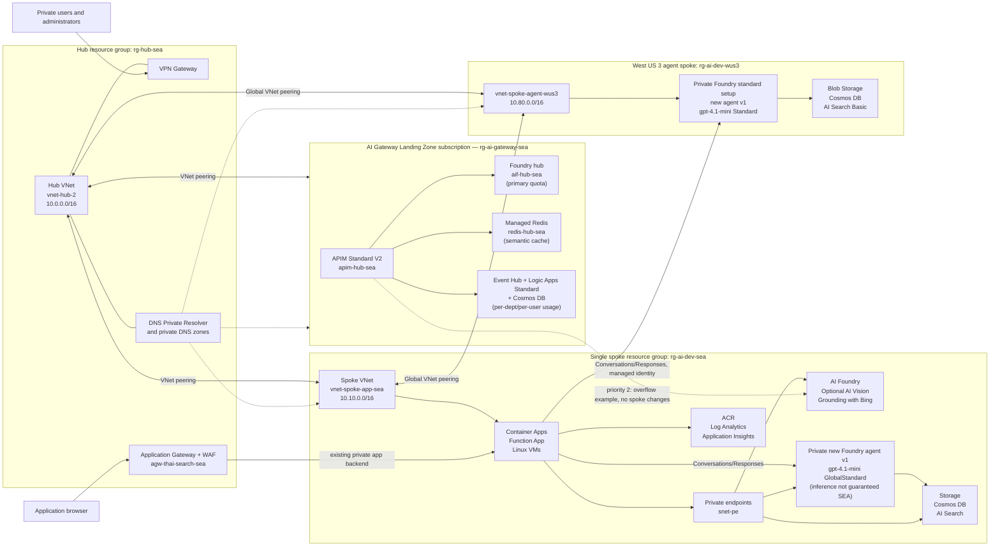

# Azure AI Landing Zone Architecture

## Overview

This repository defines a subscription-scoped Azure AI landing zone in Bicep. The orchestrator deploys one connectivity hub and exactly one workload spoke. They can reside in the same subscription or in two subscriptions within the same Microsoft Entra tenant.

A third subscription, the **AI Gateway Landing Zone hub**, is deployed alongside these two, gated by the `deployAiGateway` parameter (default `true`; see [AI Gateway Landing Zone](#ai-gateway-landing-zone-separate-subscription) below and [`docs/ai-gateway-landing-zone.md`](docs/ai-gateway-landing-zone.md) for the full design). It is additive — the existing hub and spoke require no changes.

The design has these primary goals:

- Centralize connectivity, VPN access, and private DNS in a hub.
- Host application compute and AI/data services in a single spoke.
- Keep supported data-plane services off the public network through private endpoints.
- Provide private application hosting through Azure Container Apps, Azure Functions, and Linux virtual machines.
- Deploy the environment consistently in `southeastasia`, except for global Azure resources.

The deployment entry point is [`bicep/main.bicep`](bicep/main.bicep).

### Customer service multi-agent application

[`applications/customer-service-multi-agent`](applications/customer-service-multi-agent)
owns the synthetic support workflow, authoritative simulation tools, API, browser
surface, correlated telemetry, and evaluation. Its independent release owner is
[`deploy/deploy.sh`](deploy/README.md); the landing-zone orchestrator is not
rerun to release this app.

The verified public route is
`https://customer-service-multi-agent.azuremew-domain.org` -> existing hub
`agw-thai-search-sea` WAF Prevention -> private SEA `capps-env-sea` ->
`customer-service-multi-agent`, at 0.5 CPU, 1 GiB, replicas 0-1. The app ingress
accepts the dedicated hub gateway and firewall-node subnets; existing firewall
policy forces SNAT on the gateway-to-spoke leg. A new host-specific TLS listener and HTTP
redirect preserve the existing Thai search listener and route. The public
hostname uses the existing delegated `azuremew-domain.org` zone. Certificate
renewal ownership and operator procedure belong to `deploy/README.md`.

SEA orchestration invokes namespaced native prompt agents through the private
West US 3 Foundry project using existing global peering and the existing workload
managed identity. The model is the existing regional Standard `gpt-4.1-mini`.
For local development only, an app-local gitignored `.env` can explicitly select
tenant-scoped Azure CLI credentials. Process configuration takes precedence;
deployed managed identity remains the default, with no credential fallback.
No Foundry account, model deployment or role assignment is created.
The separately approved, tenant-only secretless browser SPA obtains delegated tokens
using vendored MSAL and PKCE; only its existing-API preauthorization is added.
Incoming callers must present a signed, tenant-scoped access token
with the existing delegated scope and pass this application's object-ID allowlist.
The outbound managed identity never substitutes for caller authorization.

Conversational support has a separate owner-isolated `chat.py` service behind the same
authorization boundary. The UI and callable API share that implementation and the
simulation concurrency lock. Three Microsoft Agent Framework roles compose in
`hosted/` through `Workflow.as_agent()`, using canonical synthetic policy and telemetry.
Native source upload is the deployment path, without registry role grants; the existing
model is separate from hosted compute. Hosted version `cs-customer-service-chat:1`
is active, downloaded-source verified and exercised for two native stored-response turns
after VPN connectivity recovered. Native console readback includes all required telemetry
fields for triage, policy and resolution. The minimal UI uses automatic tenant sign-in,
one chat window and Logout; simulation and hierarchy measurement stay callable APIs,
not dashboard controls on this surface.

One service implementation serves the API and browser. Simulated transactions
never touch real orders or payments. Binary task completion is checked against
authoritative fixture/tool state; specialized factual, task, tone and consistency
judges assess semantic quality separately. Consensus, disagreement and calibration
are explicit evaluation concerns, not inferred from a successful model response.
The metric hierarchy is system -> journey type -> per-agent task accuracy,
latency, errors and tokens. Real customer resolution/reopen impact remains
unmeasured without feedback data. Stdout JSON enters existing SEA Log Analytics;
trace/span correlation and pseudonymous sessions join the decision timeline.
Deployment/readback status, exact revisions and known limitations belong to the
application README and deployment runbook, not this topology description.

### Additional regional agent spoke

[`bicep/agent-spoke.bicep`](bicep/agent-spoke.bicep) independently adds a minimal
private standard-agent spoke in subscription
`6bacd437-5d04-4afd-850e-51bdc4041496`, without redeploying the SEA orchestrator.
Its selected region is West US 3, resource group is `rg-ai-dev-wus3`, and VNet is
`vnet-spoke-agent-wus3` (`10.80.0.0/16`). `snet-agent` (`10.80.5.0/24`) is delegated
to `Microsoft.App/environments`; `snet-pe` (`10.80.6.0/24`) holds four private endpoints.

The spoke contains one Foundry account/project with agent network injection,
AAD connections, and a standard-agent capability host, plus AI Search Basic,
Blob Storage Standard LRS, serverless Cosmos DB, and a regional `gpt-4.1-mini`
Standard model deployment. Public access is disabled on all four services.
There is no additional application compute, gateway, firewall, or monitoring.

Bidirectional global VNet peerings connect the regional spoke to both `vnet-hub-2`
and `vnet-spoke-app-sea`. The hub shares its existing VPN gateway with the spoke.
Six existing hub private DNS zones are linked to its VNet; no duplicate zones
are created. Direct SEA-to-agent-spoke traffic uses VNet peering, not the SEA
default route to Azure Firewall. The AI Gateway VNet is not directly peered to
the regional spoke, because this deployment does not add AI Gateway integration.

The SEA `thai-surname-search` Container App includes **Option 6: Private Foundry
agents and regional latency**. It uses the new Conversations/Responses API, not
Classic Assistants, to invoke `regional-latency-agent` version `1` in each region.
West US 3 uses the existing global peering and `agent-project`; SEA uses the
private `foundry-agent-vnet-seaxlpu` / `agent-vnet-projectxlpu` project.
`uami-container-apps` has project-scoped Foundry User on both projects.
Agent calls and timing are implemented in
[`applications/thai-surname-search/foundry_agent.py`](applications/thai-surname-search/foundry_agent.py);
the app keeps region/browser-isolated conversations, supports fresh paired
comparisons, and captures total response time, server-observed first-token time,
TCP connection probes, and CSV measurements. Both agents use `gpt-4.1-mini`
version `2025-04-14` with identical instructions and file-search content.
West US 3 is regional Standard; SEA supports only GlobalStandard for this chat
model, so SEA inference is not guaranteed local and response-time deltas are not
a pure regional network penalty. Existing Classic agents and their data remain
untouched. The app never creates or deletes agents. Gateway/WAF and DNS are
unchanged; the gateway was verified Running on 2026-10-15.

The app offers only **Global Standard West US 3 vs Global Standard SEA** and
**Standard SEA vs Standard West US 3**. The latter is explicitly unavailable:
both SEA catalogs offered Standard only for an embedding model on 2026-10-15,
not a Standard chat model. No mixed-SKU or different-region fallback is used.
The additional West
`gpt-4.1-mini-global` deployment matches the Standard base model/version,
capacity 10, content policy and upgrade policy; it is deployed independently
with `bicep/agent-sku-comparison.bicep`. `sku-global-latency-agent:1` copies
`regional-latency-agent:1` with only the model deployment reference changed,
sharing the original vector store; the matching SEA Global agent has identical
document bytes in its own store. Actual agent/deployment metadata is checked
before calls, including model/version, SKU, capacity and corpus/settings.
Model-only comparisons disable tools. Fresh paired calls alternate
starting order, record tool/cache/token usage, and exclude warm-up, single-chat
and incomplete pairs from benchmark medians. The in-app diagram displays direct
SEA-to-West global peering, same-VNet SEA access, unmeasured browser/service hops
and the latest complete current-workload pair. Additive timelines separate setup,
API wait-to-first-text, remaining stream and local processing; coarse service
timestamps overlap rather than add. Global inference location and service load
remain uncontrolled; total response time is not pure network latency.

The transfer calculator uses USD retail checked 2026-10-15: global peering
$0.09/GB SEA + $0.035/GB West, plus $0.01/GB destination Private Link processing;
same-VNet SEA has only the latter on this leg. Request + response bytes count
once. Thus 1 GB each way is approximately $0.27 West versus $0.02 SEA, excluding
fixed endpoint hours and model/tools, compute, Gateway/common browser paths.
Observed Responses HTTP-body bytes are a partial baseline, not Azure billing
telemetry. Hidden model-backend routing does not imply customer VNet charges.

On 2026-10-14, Sweden Central could not provision Search, East US could not
provision Cosmos DB, and East US 2 could not provision Search despite available
service quotas. West US 3 successfully provisioned the complete colocated
standard-agent setup, including the regional model. The empty Sweden Central,
East US, and East US 2 trial resource groups and their external peerings and DNS
links/records were retired after the private agent workflow passed verification.

## Logical architecture

The diagram includes the SEA application spoke, the separate West US 3 agent
spoke, the connectivity hub, and the AI Gateway subscription. The agent spoke
has its own deployment entry point; `deployAiGateway = false` only skips the
AI Gateway subscription in the SEA orchestrator.

## Resource organization

The subscription deployment creates two resource groups. Each resource group can
target a different subscription through `hubSubscriptionId` and
`spokeSubscriptionId`.

| Resource group | Responsibility |
|---|---|
| `rg-hub-sea` | Hub VNet, active-active VPN Gateway, DNS Private Resolver, and centralized private DNS zones |
| `rg-ai-dev-sea` | The single workload spoke with its VNet, optional Bastion, compute, observability, AI services, data services, private endpoints, and supporting resources |
| `rg-ai-gateway-sea` | The AI Gateway hub: APIM Standard V2, API Center, hub Foundry account, Managed Redis semantic cache, and the per-department/per-user usage pipeline. Deployed in a third subscription, `aiGatewaySubscriptionId` — see [AI Gateway Landing Zone](#ai-gateway-landing-zone-separate-subscription) |

Resource names that require global uniqueness use a suffix derived from the spoke
subscription ID and spoke resource group name.

## Network topology

### Hub VNet

The default hub address space is `10.0.0.0/16`.

| Subnet | Default prefix | Purpose |
|---|---:|---|
| `default` | `10.0.0.0/24` | General hub workload subnet |
| `GatewaySubnet` | `10.0.1.0/27` | Active-active route-based VPN Gateway |
| `DnsResolverInboundSubnet` | `10.0.2.0/28` | Delegated subnet for the DNS Private Resolver inbound endpoint |
| `AzureFirewallSubnet` | `10.0.3.0/26` | Hub Azure Firewall (Basic) |
| `AzureFirewallManagementSubnet` | `10.0.4.0/26` | Azure Firewall Basic management plane |
| `snet-appgw` | `10.0.5.0/24` | Application Gateway WAF_v2 (hub) |

The hub VPN Gateway uses the `VpnGw1AZ` SKU by default and exposes gateway transit to the spoke.

### Spoke VNet

The single spoke address space is `10.10.0.0/16`.

| Subnet | Default prefix | Purpose |
|---|---:|---|
| `AzureBastionSubnet` | `10.10.0.0/26` | Reserved for optional Azure Bastion, disabled by default |
| `snet-vm` | `10.10.1.0/24` | Linux virtual machines |
| `snet-containerapps` | `10.10.2.0/23` | Delegated to the internal Container Apps environment |
| `snet-functionapp` | `10.10.4.0/24` | Delegated for Function App VNet integration |
| `snet-agent` | `10.10.5.0/24` | Reserved for agent workloads, with NAT Gateway egress |
| `snet-pe` | `10.10.6.0/24` | Private endpoints, with private endpoint network policies disabled |

All spoke subnets above are created by [`bicep/modules/spoke-network.bicep`](bicep/modules/spoke-network.bicep). The agent subnet exists as network infrastructure even though the current Foundry account module does not yet consume it.

The hub and spoke are peered in both directions. The hub permits gateway transit, and the spoke uses the hub's remote gateway.

### Foundry agent subnet status

The Foundry standard-agent private-network pattern requires two separate subnets:

- An exclusive `/24` agent subnet delegated to `Microsoft.App/environments`. Foundry uses this subnet for the account capability host and agent compute through `networkInjections.scenario: 'agent'`.
- A private endpoint subnet for the Foundry account and customer-managed data services.

This repository has the correct subnet separation:

- `snet-agent` is a `/24`, delegated to `Microsoft.App/environments`, protected by an NSG, and given explicit outbound connectivity through a NAT Gateway.
- `snet-pe` is a separate `/24` for private endpoints.

However, `snet-agent` is **not active for Foundry in the current implementation**. [`bicep/modules/cognitive-account.bicep`](bicep/modules/cognitive-account.bicep) creates private endpoints for the Foundry accounts but does not configure a `networkInjections` property or pass `spokeNetwork.outputs.agentSubnetId`. Therefore, the architecture currently provides private inbound access to Foundry but does not implement the sample's BYO VNet agent-compute injection and capability-host binding.

There are two Foundry accounts in this landing zone. The referenced standard-agent pattern states that a delegated agent subnet must be exclusive to one Foundry account. If both accounts require network-injected agents, each account should receive its own dedicated agent subnet. If only `foundry-agent-*` runs agents, the existing `snet-agent` can be reserved exclusively for that account while `foundry-app-*` continues to use private endpoints without agent injection.

### Private DNS

Private DNS is centralized in the hub and linked to both VNets:

- `privatelink.blob.core.windows.net`
- `privatelink.queue.core.windows.net`
- `privatelink.table.core.windows.net`
- `privatelink.documents.azure.com`
- `privatelink.cognitiveservices.azure.com`
- `privatelink.openai.azure.com`
- `privatelink.services.ai.azure.com`
- `privatelink.search.windows.net`

Private endpoint DNS zone groups register service records in these zones. The DNS Private Resolver inbound endpoint provides a path for connected networks to resolve the private zones when their DNS infrastructure forwards queries to it.

## Application and compute layer

### Azure Container Apps

A single VNet-integrated Container Apps managed environment hosts five applications:

All applications scale from zero to one replica.

| Application | Ingress setting | Intended role |
|---|---|---|
| `fe-app` | External | Front-end |
| `fe-app2` | External | OCR front-end |
| `be-app` | Internal | Back-end service |
| `be-app2` | Internal | Back-end service |
| `thai-surname-search` | External through WAF | Thai surname search using Azure SQL and Azure AI Search |

The managed environment is configured with `internal: true`. As a result, apps with external ingress are exposed through the environment's private load balancer rather than directly to the public internet. Back-end apps are limited to environment-level service-to-service ingress.

Application Gateway WAF_v2 lives in the hub `snet-appgw` subnet (10.0.5.0/24) with its own public IP. Its
public HTTP listener applies OWASP 3.2 rules in prevention mode and forwards
traffic over HTTPS to the private `thai-surname-search` hostname. A scoped
Origin rewrite allows Streamlit WebSockets through the reverse proxy while
keeping Streamlit CORS and XSRF protections enabled.

The hub Azure Firewall (Basic, `afw-hub-sea`) inspects spoke and AI Gateway
egress and spoke-to-AI-Gateway traffic. Route tables send `0.0.0.0/0` and the
peer VNet prefix to the firewall for the VM, Function App, and agent subnets
(spoke) and the APIM outbound and Logic Apps subnets (AI Gateway). The Application
Gateway subnet routes the spoke prefix through the firewall. The firewall always
SNATs so backends without a UDR return traffic symmetrically. Point-to-site VPN
and hub DNS traffic stay direct. Container Apps subnets use the same route table
(`enableContainerAppsFirewallRoute`; requires a workload-profiles environment).

The generated `azurecontainerapps.io` environment domain is hosted in an
Azure Private DNS zone linked to the hub and spoke VNets. Apex, wildcard, and
`*.internal` records resolve application hostnames to the environment's
private load-balancer IP.

Container logs are sent to the spoke Log Analytics workspace. The current templates use a Microsoft sample image and placeholder application settings, so production images, secrets, ports, identities, and environment variables must be supplied before deployment.

### Virtual machines

Two Ubuntu 24.04 LTS virtual machines, `myVm` and `vm-2`, are deployed to `snet-vm`.

- SSH key authentication is required.
- Password authentication is disabled.
- Public IP assignment is disabled by default.
- Azure Bastion can be enabled for private administrative access. It is disabled by default to avoid its fixed hourly charge.
- Each NIC is associated with a dedicated NSG.
- The Microsoft Defender for Endpoint Linux extension is optional and disabled
  by default. Enable it only after Defender for Servers/MDE onboarding is configured.

### Function App

The Function App stack includes:

- A Linux Function App running .NET 8 isolated worker.
- A serverless Flex Consumption `FC1` plan that scales to zero.
- Cost-focused defaults of 512 MB per instance and a 40-instance maximum.
- No always-ready instances, avoiding idle compute charges.
- A user-assigned managed identity.
- VNet integration through `snet-functionapp`.
- Route-all behavior for outbound traffic.
- Workspace-based Application Insights.
- A dedicated private storage account using managed identity instead of account keys.
- A deployment package Blob container and Blob, Queue, and Table private endpoints.
- An optional dedicated Durable Task Scheduler that is disabled by default to avoid fixed capacity cost.

## AI and data platform

### Azure AI Foundry

Two `AIServices` accounts are deployed with system-assigned identities:

| Account purpose | Project |
|---|---|
| Application AI | `firstProject` |
| Agent workloads | `projectrbjp` |

Each account disables public network access and uses a private endpoint associated with the Cognitive Services, Azure OpenAI, and Azure AI Services private DNS zones. Each Foundry project also has a system-assigned identity.

Two global Grounding with Bing accounts support Foundry agent scenarios. These resources do not use private endpoints.

### Data services

| Service | Count | Network posture |
|---|---:|---|
| StorageV2 | 4 | Public network disabled, Blob private endpoint on each account; Queue and Table private endpoints added to Function storage |
| Cosmos DB for NoSQL | 2 | Public network disabled, SQL private endpoint |
| Azure AI Search Basic | 1 | Public network disabled, search private endpoint |
| Computer Vision | 0 by default, optionally 1 | Public network disabled, Cognitive Services private endpoint |

All private endpoints are placed in `snet-pe` and associated with hub-hosted private DNS zones.

### Container registry

The landing zone creates one Standard Azure Container Registry with the admin account disabled. The current templates do not yet connect Container Apps to ACR, assign image-pull roles, or add a registry private endpoint.

## Observability

The spoke contains a Log Analytics workspace with 180-day retention.

- Container Apps sends platform and application logs directly to Log Analytics.
- Application Insights is workspace-based and monitors the Function App.
- VM-level monitoring beyond the Defender for Endpoint extension is not configured in this export.
- Diagnostic settings for PaaS resources are not configured in the current templates.

## Security model

Implemented controls include:

- Private endpoints and disabled public network access for Storage, Cosmos DB, AI Search, optional Computer Vision, and AI Foundry accounts.
- Centralized private DNS linked to both hub and spoke networks.
- Private Container Apps environment.
- Optional Bastion-based VM administration with no VM public IPs by default.
- SSH-only VM authentication.
- Managed identities on AI accounts, Foundry projects, and the Function App.
- TLS 1.2 minimum and public blob access disabled on Storage.
- ACR admin credentials disabled.
- HTTPS-only Function App traffic.

The deployment does not create RBAC role assignments between workloads and services. Identity-based access, least-privilege roles, application secrets, and service-specific authorization must be configured as part of workload onboarding.

## Key traffic flows

### Administrative access

1. A private or VPN-connected administrator reaches the hub VPN Gateway.
2. Hub-to-spoke peering carries traffic into the spoke.
3. When enabled, Azure Bastion provides SSH access to the VMs without VM public IP addresses.

### Private service access

1. A workload resolves an Azure service hostname.
2. The linked private DNS zone returns the private endpoint address.
3. Traffic remains in the spoke VNet and reaches the service through `snet-pe`.

### Container application traffic

1. A caller connected to the private network reaches a front-end app through the internal Container Apps environment.
2. Front-end apps call `be-app` or `be-app2` over internal Container Apps networking.
3. Applications access AI and data services through private endpoints.

### Function processing

1. The Function App receives traffic through its App Service endpoint and sends outbound traffic through VNet integration.
2. Storage and other private services are resolved through centralized private DNS.
3. Telemetry is written to Application Insights and Log Analytics.

## Deployment model

`bicep/main.bicep` is a subscription-scope orchestrator. Bicep output references establish the dependency graph:

1. Create the hub and spoke resource groups.
2. Deploy hub and spoke networking.
3. Create centralized private DNS zones and link both VNets.
4. Establish bidirectional VNet peering and gateway transit.
5. Deploy Log Analytics.
6. Deploy private data and AI services.
7. Deploy VMs, Container Apps, and the Function App stack.

The sample parameters are in [`bicep/parameters/main.bicepparam`](bicep/parameters/main.bicepparam).

## Design constraints and deployment readiness

The checked-in templates are an exported and consolidated baseline, not a production-ready application deployment. Confirm or address these items before deployment:

- Replace the placeholder hub and spoke CIDR ranges and verify that they do not overlap with connected networks.
- Supply SSH public keys securely at deployment time.
- Replace sample Container Apps images and configure application ports, settings, secrets, identities, and ACR access.
- Define RBAC assignments for all managed identities.
- Review NSG rules. Most workload NSGs currently contain no custom rules.
- Decide whether ACR requires public network restrictions and a private endpoint.
- Review local authentication settings. AI Search and Cognitive Services currently permit local authentication.
- Add any additional Storage private endpoints, such as File, only when an application workload requires them. Function host storage already includes Blob, Queue, and Table.
- If the optional Durable Task Scheduler is enabled, replace its current `0.0.0.0/0` allowlist with the required private or restricted source ranges.
- Complete the required VPN client or site-to-site configuration. The template creates the gateway but does not define connections or client address pools.
- Add diagnostic settings, alerting, backup, disaster recovery, policy, Defender plans, budgets, and resource locks as required by the target environment.
- Validate regional service availability and quota in `southeastasia`.
- Keep `enableBastion=false` when no interactive VM administration is required.
- Confirm that Azure AI Search Basic capacity and feature limits meet indexing and query requirements.

## AI Gateway Landing Zone (separate subscription)

A **third subscription**, the AI Gateway Landing Zone
(`aiGatewaySubscriptionId`, default `0d04b43f-7d15-40fd-8aa5-830f71ab0d80`,
resource group `rg-ai-gateway-sea`), is deployed alongside the hub and spoke
described above, gated by `deployAiGateway` (default `true`). It is additive:
the spoke keeps its existing model capacity and receives only project-level
`ApiManagement` connections that expose the centralized hub model. Full design
details, diagrams, and the implemented-module appendix are in
[`docs/ai-gateway-landing-zone.md`](docs/ai-gateway-landing-zone.md).

| Component | Purpose |
|---|---|
| `apim-hub-sea<suffix>` (APIM Standard V2) | Single governed entry point for all AI callers; public gateway hostname, outbound VNet-integrated to reach private backends |
| `apic-hub-sea<suffix>` (Azure API Center) | Continuously synchronized inventory of APIM REST APIs and MCP servers for discovery and governance |
| `aif-hub-sea<suffix>` (Foundry hub account) | Shared model deployments — `gpt-4o-hub-prod` (underlying model `gpt-4.1-mini`; `gpt-4o`'s `GlobalStandard` SKU only maps to fine-tune quota in this tenant/region per a live `what-if` preflight check) and `text-embedding-3-small` (`GlobalStandard`); the **primary** quota target for gateway traffic |
| `hub-ai-gateway/gpt-4o-hub-prod` (spoke resources) | Resource-scoped admin-connected model registered in both spoke Foundry resources and available to all their projects. Capacity stays in the hub account while spoke prompt agents route inference through APIM. |
| `redis-hub-sea-<suffix>` (Azure Managed Redis, RediSearch) | Semantic caching of prompt/response pairs behind APIM |
| `evhns-hub-sea-<suffix>` + `logic-hub-usage-sea<suffix>` | Usage-metering pipeline: token events flow to Event Hub / Application Insights, processed by a **Logic Apps Standard** workflow (`logic-app-workflows/usage-rollup/workflow.json`, zip-deployed) that upserts daily rollups into `cosmos-hub-sea-<suffix>` (Consumption is not supported for Foundry's Logic Apps connector/agent-tool pattern) |
| `cosmos-hub-sea-<suffix>` (Cosmos DB, serverless) | Durable per-department/per-user/per-model daily usage store (`usage`/`token-usage-daily`, partitioned by `/department`) — the queryable showback/chargeback backing store |
| `kv-aigw-<suffix>`, `stlogicaigw<suffix>`, `appi-apim-sea`, `workspace-ai-gateway-sea` | Supporting secrets, Logic App content storage, Application Insights, and Log Analytics for the above |

**Cost tracking per department and per user.** Each call is attributed by
APIM Product/Subscription (department boundary, one pair per entry in the
`aiGatewayDepartments` parameter) and an Entra ID JWT claim (user boundary),
stamped onto the `llm-emit-token-metric` policy — so new departments onboard
with just a new APIM Subscription, and new users are tracked automatically
from their token claim, with no gateway-side registration step.

**Quota overflow is hub-first.** Because Foundry quota is allocated per
subscription, `aif-hub-sea<suffix>` is the priority-1 backend and consumes
all quota first; the existing spoke's Foundry account (`foundryAccountApp`)
is registered as a priority-2 example backend that APIM fails over to on
`429`/`503` responses via `authentication-managed-identity` policy, with no
changes required in the spoke itself. APIM's system-assigned identity is
granted `Cognitive Services User` on both Foundry accounts.

## Source map

| Area | Bicep source |
|---|---|
| Subscription orchestration | [`bicep/main.bicep`](bicep/main.bicep) |
| Regional standard-agent spoke | [`bicep/agent-spoke.bicep`](bicep/agent-spoke.bicep), [`bicep/modules/foundry-standard-agent.bicep`](bicep/modules/foundry-standard-agent.bicep) |
| Hub network | [`bicep/modules/hub-network.bicep`](bicep/modules/hub-network.bicep) |
| Spoke network | [`bicep/modules/spoke-network.bicep`](bicep/modules/spoke-network.bicep) |
| AI Gateway network | [`bicep/modules/ai-gateway-network.bicep`](bicep/modules/ai-gateway-network.bicep) |
| Private DNS | [`bicep/modules/dns-zones.bicep`](bicep/modules/dns-zones.bicep) |
| Private endpoints | [`bicep/modules/private-endpoint.bicep`](bicep/modules/private-endpoint.bicep) |
| Container Apps | [`bicep/modules/container-apps-environment.bicep`](bicep/modules/container-apps-environment.bicep), [`bicep/modules/container-app.bicep`](bicep/modules/container-app.bicep) |
| Function App | [`bicep/modules/function-app.bicep`](bicep/modules/function-app.bicep) |
| Virtual machines | [`bicep/modules/virtual-machine.bicep`](bicep/modules/virtual-machine.bicep) |
| AI services | [`bicep/modules/cognitive-account.bicep`](bicep/modules/cognitive-account.bicep), [`bicep/modules/foundry-project.bicep`](bicep/modules/foundry-project.bicep) |
| Data services | Storage, Cosmos DB, and AI Search modules under [`bicep/modules/`](bicep/modules/) |
| AI Gateway (APIM, API Center, Redis, Foundry hub, usage pipeline) | [`bicep/modules/apim.bicep`](bicep/modules/apim.bicep), [`bicep/modules/api-center.bicep`](bicep/modules/api-center.bicep), [`bicep/modules/managed-redis.bicep`](bicep/modules/managed-redis.bicep), [`bicep/modules/event-hub-namespace.bicep`](bicep/modules/event-hub-namespace.bicep), [`bicep/modules/logic-app-standard.bicep`](bicep/modules/logic-app-standard.bicep), [`bicep/modules/policies/`](bicep/modules/policies/) |
