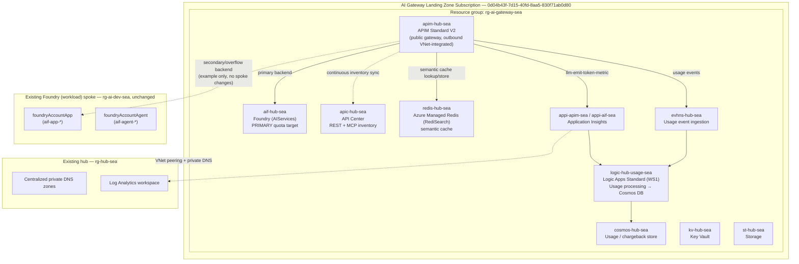
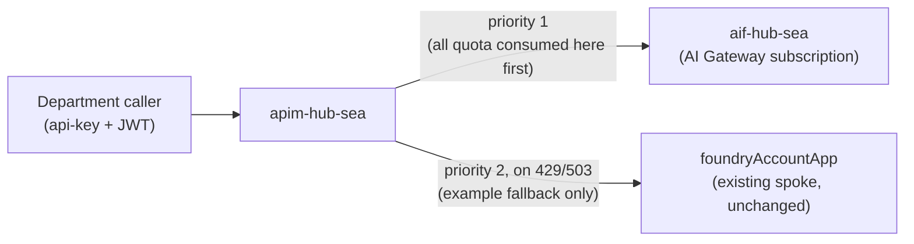

# AI Gateway Landing Zone

## Status

**Implemented.** The Bicep in [`bicep/main.bicep`](../bicep/main.bicep) and
[`bicep/modules/`](../bicep/modules/) deploys this as a **third** subscription
scope alongside the two hub/spoke scopes, gated by `deployAiGateway` (default
`true`):

| Scope | Subscription | Status |
|---|---|---|
| Hub (`rg-hub-sea`) | `hubSubscriptionId` | Existing, unchanged |
| Spoke (`rg-ai-dev-sea`) | `spokeSubscriptionId` | Existing, with example MCP Container Apps and direct gateway peering |
| **AI Gateway** (`rg-ai-gateway-sea`) | `aiGatewaySubscriptionId` (default `0d04b43f-7d15-40fd-8aa5-830f71ab0d80`) | **Implemented** |

Set `deployAiGateway = false` in `parameters/main.bicepparam` to skip this
subscription and deploy only the existing hub/spoke topology. See
`bicep/README.md`'s "AI Gateway Landing Zone" section for the module list and
deployment assumptions to confirm (Redis Enterprise API surface, Logic Apps
Standard content-storage approach, etc.).

## Why a separate subscription

Azure AI Foundry quota (TPM/RPM per model) is allocated **per subscription**,
not per tenant. Putting the shared gateway, the "hub" Foundry account, and the
semantic-cache Redis in their own subscription:

- gives departments a single governed entry point instead of direct Foundry
  access,
- keeps the gateway's own quota, budget, and RBAC boundary separate from any
  one workload spoke,
- matches the Azure/AI-Landing-Zones reference architecture, which places
  API Management, the governance Foundry account, and the usage/metering
  services in a dedicated **AI Gateway Landing Zone Subscription**, separate
  from each **Foundry (workload) Landing Zone Subscription**.

## Reference sources

- Azure/AI-Landing-Zones reference diagram (management groups →
  Connectivity / Application landing zones, with a dedicated **AI Gateway
  Landing Zone Subscription** containing an **AI Hub Resource Group**: APIM,
  AI Gateway subnet, Logic Apps subnet, Governance Supporting Services
  (Event Hub, Cosmos DB, Key Vault, Storage, Managed Redis Semantic Cache),
  Gov Workflows, AI Registry).
- `Azure-Samples/ai-hub-gateway-solution-accelerator` (branch `citadel-v1`),
  as documented in the Ascentium "AI Landing Zone - Technical Handout"
  supplied for this design: APIM StandardV2, 3 regional Foundry accounts,
  Managed Redis (RediSearch) semantic cache, Event Hub → Logic App → Cosmos
  DB usage pipeline, APIM Products per team as the chargeback boundary,
  `llm-emit-token-metric` policy with custom-metric dimensions.

## Subscription / resource-group layout

## Networking

- A new VNet is created in the AI Gateway subscription and peered to the
  existing hub (`rg-hub-sea`), the same way the current spoke is peered
  today, so it inherits the repo's centralized private-DNS model instead of
  duplicating DNS zones.
- The gateway VNet is also directly peered with the application spoke because
  VNet peering is not transitive. This path lets APIM reach the internal
  Container Apps examples in `applications/mcp-examples/`.
- **APIM Standard V2** uses **outbound VNet integration** from a dedicated
  subnet to reach Foundry, Redis, Cosmos DB, Event Hub, and Key Vault over
  private endpoints. Standard V2 does not support inbound private endpoints;
  the gateway keeps its public `*.azure-api.net` hostname as the single
  ingress, protected by APIM subscription keys and JWT validation. If fully
  private ingress is required later, the upgrade path is APIM
  Premium/Premium v2.
- Private endpoints (in a `snet-pe`-style subnet) for: `aif-hub-sea`,
  `redis-hub-sea`, `cosmos-hub-sea`, `evhns-hub-sea`, `kv-hub-sea`,
  `st-hub-sea`. Public network access is disabled on all of them.
- Additional private DNS zones to add to the hub's centralized zone set
  (alongside the zones already listed in [`ARCHITECTURE.md`](../ARCHITECTURE.md)):
  - `privatelink.redis.azure.net`
  - `privatelink.servicebus.windows.net`
  - `privatelink.vaultcore.azure.net`
  - `privatelink.documents.azure.com` (already exists — reused, not duplicated)
  - Standard blob/table/queue zones (already exist — reused for `st-hub-sea`)

## Logic Apps: plan requirement for Foundry connectivity

Foundry Agent Service can call out to an Azure Logic App as an agent **tool**
(action), and Logic Apps can in turn call back into Foundry agents as a
workflow trigger/action. Both directions are gated by plan:

- The Microsoft-published **Azure AI Foundry Agent Service connector** is
  only available for **Logic Apps (Standard)** — it is explicitly *not*
  listed for Logic Apps Consumption. This is the connector used to run
  Foundry agent actions and to trigger/run workflows from an agent.
- A Logic App exposed *as a tool to a Foundry agent* (HTTP-trigger workflow
  described to the agent via an OpenAPI/Swagger schema, authenticated with a
  managed identity) is documented and demonstrated only against **Standard**
  workflows. Consumption's HTTP trigger can technically respond to a raw
  HTTP call, but it does not carry the managed-identity-based auth model or
  the multi-workflow/VNet-integration story the agent-tool pattern relies on
  in production.
- **Decision for this design:** `logic-hub-usage-sea<suffix>` is a **Logic Apps
  Standard** resource (WS1 plan), not Consumption. This matches the
  Ascentium/Citadel reference (`logicapp.bicep` hosts a Standard Logic App)
  and means the same resource can, if needed later, also expose an
  agent-callable workflow (e.g. "look up this department's current spend
  before approving a large request") using the same connector Foundry
  officially supports — without provisioning a second Logic App.
- Practical wiring for the agent-tool direction, when adopted:
  1. Add a **Stateful Workflow** on `logic-hub-usage-sea<suffix>` with an
     **HTTP Request** trigger and a defined JSON schema.
  2. Expose its Swagger/OpenAPI definition and register a **system-assigned
     managed identity** on the Logic App, least-privilege scoped.
  3. Register the workflow as an `openapi`-type tool on the relevant Foundry
     agent (`auth_type: managed_identity`), pointing at the workflow's
     `swagger.json`.
  4. The usage-ingestion workflow and any agent-tool workflows can live as
     separate workflows inside the same Logic Apps Standard resource.

## Cost / chargeback model: per-department and per-user token spend

Every gateway call carries three attribution dimensions before token usage is
recorded:

| Dimension | Source | Example value |
|---|---|---|
| **Department** | APIM **Product + Subscription** — the `api-key` presented by the caller | `ODI`, `FA` |
| **User** | Entra ID JWT claim (`oid` or `upn`), validated by a `validate-jwt` inbound policy | `alice@contoso.com` |
| **Model / deployment** | The `{deployment}` path segment on the OpenAI-compatible route | `gpt-4o-odi-prod` |

### Pipeline

1. **`validate-jwt`** (inbound policy) verifies the caller's Entra ID token
   and extracts the user claim into a `context.Variables` entry.
2. **`llm-emit-token-metric`** (namespace `llm-usage`) emits a custom metric
   to Application Insights per call, dimensioned by `product` (department),
   `user`, `deployment`, `promptTokens`, `completionTokens`, `totalTokens`.
3. The same policy path (or a parallel `log-to-eventhub` policy) writes a
   compact JSON usage event to `evhns-hub-sea` for the durable audit trail.
4. **`logic-hub-usage-sea<suffix>`** (Logic Apps **Standard**, WS1 — see above) — a
   scheduled workflow — queries Application Insights `customMetrics`
   (namespace `llm-usage`) via KQL and/or drains Event Hub, then upserts
   daily rollups keyed by `(department, user, deployment, date)` into
   `cosmos-hub-sea`.
5. **Cosmos DB** is the queryable showback/chargeback store; **Log
   Analytics** (`ApiManagementGatewayLlmLogs`, reusing the existing hub
   workspace) keeps the raw diagnostic trail for audit.
6. Departments get a Cosmos DB partition (partition key = `department`) they
   can be granted read-only access to, or a Power BI / Azure Monitor
   workbook can be built on top for self-service dashboards.

### Onboarding a new department or user

- **New department**: create one APIM Product + Subscription — no infra
  redeploy, no code change to the usage pipeline.
- **New user**: nothing to provision — the JWT claim is captured
  automatically the first time that user calls the gateway under their
  department's subscription key.

## Quota / overflow routing: hub-first, spoke as fallback example

Foundry quota is per-subscription, so the AI Gateway subscription's quota and
the spoke's quota cannot pool automatically. Overflow is handled at the APIM
layer with a **backend pool**, and the routing priority requested is
**hub-first**:

- **Backend 1 — priority 1 (primary)**: `aif-hub-sea` deployment in the AI
  Gateway subscription. All traffic is served here first, so quota in the AI
  Gateway subscription is consumed before anything else.
- **Backend 2 — priority 2 (secondary / worked example)**: the existing
  spoke's `foundryAccountApp` (or `foundryAccountAgent`) deployment in
  `rg-ai-dev-sea`. This is registered purely to demonstrate cross-subscription
  overflow. This backend route itself requires no additional spoke deployment;
  separately, each spoke project receives an admin-connected model reference
  so its prompt agents can intentionally call the hub gateway.
- A `retry`/`choose` policy on `429 (RateLimitExceeded)` or `503` responses
  from Backend 1 fails over to Backend 2 within the same client call.
- Both backends are stamped with the **same** `deployment` dimension in the
  usage-metering policy, so chargeback reports stay accurate regardless of
  which subscription actually served a given request — the model/deployment
  name, not the serving subscription, is the reporting key.

## Appendix: implemented Bicep modules

These are flat under `bicep/modules/` (no `ai-gateway/` subfolder, matching
the existing repo convention of one module per file), wired into
`main.bicep` behind `deployAiGateway`:

| Module (actual) | Responsibility |
|---|---|
| `modules/resource-group.bicep` | Reused as-is for `rg-ai-gateway-sea` (`aiGatewayRg`) |
| `modules/ai-gateway-network.bicep` | New VNet (`snet-apim-outbound`, `snet-pe`, `snet-logicapp`), peered to `rg-hub-sea` via the existing `vnet-peering-hub-side.bicep`/`vnet-peering-spoke-side.bicep` |
| `modules/apim.bicep` | APIM Standard V2, Products/Subscriptions per department, 3 backends (hub/spoke/embeddings) with circuit breaker + hub-first retry, policy fragment includes |
| `modules/policies/*.xml` | `frag-validate-jwt.xml`, `frag-llm-token-metric.xml`, `frag-semantic-cache-lookup.xml`/`frag-semantic-cache-store.xml`, `frag-backend-failover.xml` (uses `authentication-managed-identity`, not backend-resource credentials — APIM's `backends` resource schema does not support a managed-identity credential type), `api-policy.xml`, `default-product-policy.xml` |
| `modules/cognitive-account.bicep` + `modules/foundry-project.bicep` + `modules/cognitive-deployment.bicep` | Reused existing account/project modules for `aif-hub-sea<suffix>` and its `foundryProjectHub`; new `cognitive-deployment.bicep` adds the `gpt-4o-hub-prod` (underlying model **`gpt-4.1-mini`**, see note below) and `text-embedding-3-small` model deployments |
| `modules/managed-redis.bicep` | Azure Managed Redis (RediSearch) with private endpoint |
| `modules/event-hub-namespace.bicep` + `modules/logic-app-standard.bicep` | Event Hub namespace/hub (with an APIM `azureEventHub` logger + `log-to-eventhub` audit trail), Logic App Standard (WS1) host running the daily `usage-rollup` workflow |
| `modules/cosmos-account.bicep` (reused, `enableServerless: true`) + `modules/cosmos-sql-database.bicep` + `modules/cosmos-sql-role-assignment.bicep` | `cosmos-hub-sea<suffix>` serverless account, `usage`/`token-usage-daily` database+container (partitioned by `/department`), and the Cosmos DB data-plane RBAC (`sqlRoleAssignments`) granting the Logic App's identity Data Contributor |
| `bicep/logic-app-workflows/usage-rollup/workflow.json` + `bicep/scripts/deploy-logic-app-workflow.sh` | The actual usage-rollup workflow content (daily recurrence → Log Analytics Query API over `customMetrics` → upsert into Cosmos DB), zip-deployed after the Bicep run since Logic Apps Standard workflow definitions cannot be Bicep resources |
| `modules/key-vault.bicep`, `modules/storage-account.bicep` (reused), `modules/app-insights.bicep`, `modules/log-analytics.bicep` (reused) | Key Vault, Logic App content storage, Application Insights, Log Analytics workspace |
| `main.bicep` additions | `deployAiGateway`, `aiGatewaySubscriptionId`, `aiGatewayResourceGroupName`, `apimPublisherEmail`, `entraAudience`, `aiGatewayDepartments` params; module blocks wired the same way `hubRg`/`spokeRg` are; role assignments granting APIM's system-assigned identity `Cognitive Services User` (hub + spoke Foundry accounts), `Azure Event Hubs Data Sender`, and `Key Vault Secrets User`; the Logic App's identity gets `Log Analytics Reader`, the Cosmos DB data role, and `Key Vault Secrets User` |

Deviations from the original proposal worth noting:
- `redis` access uses the database's `listKeys()` primary key surfaced
  directly to APIM's named value/cache resource, rather than Key Vault
  indirection — acceptable for this iteration since the connection string
  never leaves the APIM control plane. Both APIM and the Logic App already
  hold `Key Vault Secrets User` on `kv-aigw-<suffix>`, so migrating this to a
  Key Vault-backed secret is a small follow-up once secret rotation is needed.
- The `usage-rollup` workflow's Log Analytics Query API KQL assumes a fixed
  column order (`department, userId, deployment, day, totalTokens`) from its
  `summarize` clause and maps response rows by index rather than by column
  name — acceptable for a first cut, but brittle if the query is edited
  without updating the workflow's row-mapping expressions to match.
- **The hub chat deployment (`gpt-4o-hub-prod`) actually deploys `gpt-4.1-mini`,
  not `gpt-4o`.** This was discovered via a real `az deployment sub what-if`
  preflight run: `az cognitiveservices account list-models` showed that in this
  tenant/region, every `gpt-4o` version's `GlobalStandard` SKU maps to a
  **fine-tune-only** usage quota (`OpenAI.GlobalStandard.gpt-4o-finetune`), not
  the base chat quota — so a real `GlobalStandard` chat deployment of `gpt-4o`
  fails preflight validation ("SKU 'GlobalStandard' for model 'gpt-4o ...' is
  not supported in this region"), even though subscription-level quota for
  plain `gpt-4o` chat exists. `gpt-4.1-mini` (version `2025-04-14`) has a
  confirmed, actively-used `GlobalStandard` chat mapping
  (`OpenAI.GlobalStandard.gpt4.1-mini`) and was substituted instead. The
  deployment *name* (`gpt-4o-hub-prod`) was left as-is for API-route
  continuity with the rest of the doc — re-check your own subscription's model
  catalog before assuming `gpt-4o` is deployable as-is.
- **`text-embedding-3-small` (version `1`) does not support a plain `Standard`
  SKU** in this region — only `GlobalStandard`/`DataZoneStandard`. Fixed to
  `GlobalStandard` after the same preflight validation caught it.

## Risks / open items to revisit before implementation

- Standard V2's public gateway hostname means the `api-key` + JWT combination
  is the only boundary protecting Foundry from the internet-facing side.
  Escalate to Premium/Premium v2 if full private ingress becomes a hard
  requirement.
- Anthropic/Claude-style models need the dedicated Anthropic Messages routing
  fragment (per the Ascentium reference); treated as a future customization,
  not required for the initial design.
- Semantic caching needs an embeddings backend (e.g.
  `text-embedding-3-small`) on `aif-hub-sea`, authenticated via APIM's
  system-assigned managed identity granted `Cognitive Services User` on that
  account.
- Confirm regional quota/capacity for `aif-hub-sea` model deployments in
  `southeastasia` before assuming it can always be primary.
- The hub chat deployment is also registered as a resource-scoped
  **admin-connected model** on both spoke Foundry resources through an
  `ApiManagement` connection named `hub-ai-gateway`. Foundry makes the
  connection available to every project in each resource. This does not
  duplicate model capacity in the spoke subscription. Prompt agents reference
  the centralized model as `hub-ai-gateway/gpt-4o-hub-prod`, and their
  inference traffic flows through APIM for the same policies, metering, and
  hub-first backend routing.
